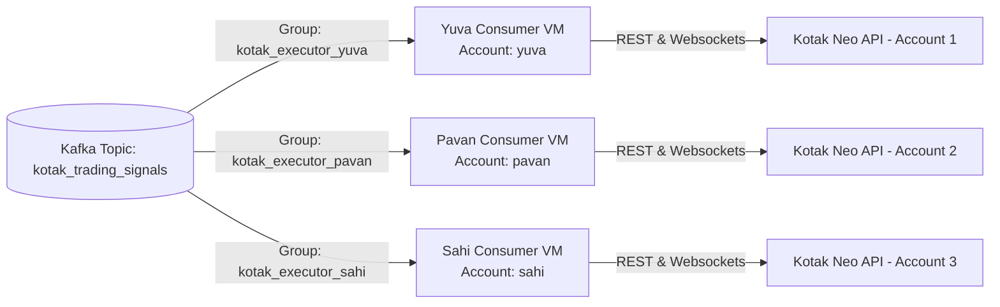

# Kotak Neo Order Consumer

The **Kotak Order Consumer** is an account-level automated trade execution engine for Indian derivatives (NIFTY / BANKNIFTY / SENSEX options). It consumes trading signals from an Apache Kafka broker, resolves live contracts and active expiries, calculates position sizing, and executes real-time orders through the **Kotak Neo API**.

> [!WARNING]
> **Live Trading Daemon:** This service places real market and stop-limit orders with your broker. Verify all risk management limits, account credentials, and lot sizes before running in production.

---

## Architecture



### Multi-Account & Multi-VM Isolation
- **Independent Consumer Groups**: Every consumer VM runs with its own distinct `KAFKA_CONSUMER_GROUP_ID` (e.g. `kotak_executor_yuva`, `kotak_executor_pavan`, `kotak_executor_sahi`).
- **Full Signal Duplication**: In Kafka, each consumer group receives its own independent copy of every message. An order execution, fill, or failure on one account has zero impact on other accounts.

---

## Order Management & Strategy Features

### 1. Robust Scrip & Expiry Resolution
- Resolves active weekly/monthly option contracts via Kotak Neo scrip master.
- Features locale-independent regex parsing for date and month formats to prevent month/date parsing failures.

### 2. Multi-Target Staged Exits & Trailing Stop-Loss
- **Entry Sizing**: Defaults to multiples of 3 lots (e.g. 3, 6, 9 lots) or risk-based sizing.
- **Protective Stop-Loss**: Places a protective sell stop-limit order immediately upon entry fill.
- **Trailing Milestones**:
  - **Target 1 reached**: Sells 1/3 quantity; moves protective stop on remaining lots to the average entry price (cost-to-cost).
  - **Target 2 reached**: Sells 1/3 quantity; moves protective stop to Target 1.
  - **Target 3 reached**: Closes the remaining position.

### 3. Immediate Market Exit on Any Exit Signal
When an exit instruction arrives (e.g. *"Exit at cost to cost"*, *"Exit @253"*, *"close position"*, *"square off"*, or *"exit"*):
- If the position is open (`open_quantity > 0`):
  1. **Cancels the active protective stop-loss order** and any pending target exits on Kotak Neo.
  2. Submits an **immediate Market SELL order** for the entire open quantity.
  3. Transitions trade state to `CLOSED`.
- If the entry order is still pending (unfilled): cleanly cancels the pending entry order.

---

## Configuration (`.env`)

Each VM maintains its own private `.env` file at `/home/<user>/apps/neo-tel-order-processor/.env`:

| Variable | Description |
| :--- | :--- |
| `ACCOUNT_ID` | Account identifier shown in logs (e.g., `yuva`, `pavan`, `sahi`). |
| `KAFKA_CONSUMER_GROUP_ID` | Unique Kafka consumer group (e.g., `kotak_executor_yuva`). |
| `KAFKA_BOOTSTRAP_SERVERS` | Remote Kafka address (e.g., `<OCI_KAFKA_PUBLIC_IP>:9092`). |
| `KAFKA_TOPIC_SIGNALS` | Kafka topic name (defaults to `kotak_trading_signals`). |
| `KOTAK_CONSUMER_KEY` | Kotak Neo Consumer API Key. |
| `KOTAK_CONSUMER_SECRET` | Kotak Neo Consumer Secret. |
| `KOTAK_MOBILE_NUMBER` | Registered mobile number. |
| `KOTAK_UCC` | Unique Client Code (UCC). |
| `KOTAK_PASSWORD` | Kotak account password. |
| `KOTAK_TOTP_KEY` | Base32 TOTP Secret Key (used to auto-generate 6-digit TOTP). |
| `KOTAK_MPIN` | 6-digit MPIN. |
| `DEFAULT_LOTS` | Default order size (default: `3`). |
| `DEFAULT_PRODUCT_TYPE` | `MIS` (Intraday) or `NRML` (Carry Forward). |
| `SL_LIMIT_BUFFER_PERCENT` | Limit price buffer for stop-limit orders (default: `3.0`). |

---

## Automated Deployment (GitHub Actions)

Deployments are orchestrated via [`.github/workflows/deploy.yml`](.github/workflows/deploy.yml) and run automatically on push to `main`.

### Active Deployment Targets
The workflow deploys to all active consumer VMs in parallel:
- **`deploy-yuva`** $\rightarrow$ Deploys to `GCP_VM_HOST_YUVA`
- **`deploy-pavan`** $\rightarrow$ Deploys to `GCP_VM_HOST_PAVAN`
- **`deploy-sahi`** $\rightarrow$ Deploys to `GCP_VM_HOST_SAHI`

### GitHub Settings Setup
In **Settings $\rightarrow$ Secrets and variables $\rightarrow$ Actions**:
1. **VM IP Addresses** (as Secrets or Variables):
   - `GCP_VM_HOST_YUVA`
   - `GCP_VM_HOST_PAVAN`
   - `GCP_VM_HOST_SAHI`
2. **Shared SSH Credentials** (used by all VMs):
   - `GCP_VM_SSH_KEY`: Private SSH deployment key.
   - `GCP_VM_USER`: Linux account name (e.g. `pawanbudati`).
   - `GCP_VM_SSH_PORT`: Optional, defaults to `22`.
   - `GCP_VM_KNOWN_HOSTS`: SSH host keys.

### Automated Server Setup Features:
1. **Self-Healing Environment**: Automatically detects if `python3-venv` or `python3-pip` is missing on fresh Ubuntu VMs and installs them via `apt`.
2. **Daily 8:00 AM Pre-Market Clean Restart**: Installs a root cron job in `/etc/cron.d/journal-log-cleanup`:
   ```cron
   0 8 * * * root journalctl --rotate && journalctl --vacuum-time=1s && systemctl restart neo-tel-order-processor.service >/dev/null 2>&1
   ```
   **Benefits**:
   - Triggers fresh daily authentication with Kotak Neo API before market open (re-generating session tokens).
   - Purges yesterday's journal logs so each day begins with an empty, fast-reading log file.

---

## Manual Deployment (No GitHub Actions)

Deploy to any VM directly from your local terminal using the included scripts:

### From Windows (PowerShell):
```powershell
cd consumer

# Deploy to all 3 VMs (Yuva, Pavan, Sahi):
.\deploy\manual_deploy.ps1

# Deploy to an individual VM:
.\deploy\manual_deploy.ps1 -Target yuva
.\deploy\manual_deploy.ps1 -Target pavan
.\deploy\manual_deploy.ps1 -Target sahi

# Deploy passing VM host directly:
.\deploy\manual_deploy.ps1 -Target pavan -VmHost "34.xx.xx.xx"
```

### From Linux / macOS / Git Bash:
```bash
cd consumer

./deploy/manual_deploy.sh all
./deploy/manual_deploy.sh yuva
./deploy/manual_deploy.sh pavan
./deploy/manual_deploy.sh sahi
```

---

## Service Management & Monitoring

Run these commands on any consumer VM:

```bash
# Check service health
sudo systemctl status neo-tel-order-processor

# Stream live real-time trading logs
sudo journalctl -u neo-tel-order-processor -f

# View logs from today only
sudo journalctl -u neo-tel-order-processor --since today

# Restart consumer manually
sudo systemctl restart neo-tel-order-processor
```

### Checking Active Consumer Groups on OCI Kafka
Run directly on your **OCI Kafka VM** to monitor all consumer VMs:
```bash
docker exec trading-kafka /opt/kafka/bin/kafka-consumer-groups.sh \
  --bootstrap-server localhost:9092 \
  --describe \
  --group kotak_executor_yuva

docker exec trading-kafka /opt/kafka/bin/kafka-consumer-groups.sh \
  --bootstrap-server localhost:9092 \
  --describe \
  --group kotak_executor_pavan

docker exec trading-kafka /opt/kafka/bin/kafka-consumer-groups.sh \
  --bootstrap-server localhost:9092 \
  --describe \
  --group kotak_executor_sahi
```
All connected groups should display `LAG = 0` and active client assignments.
