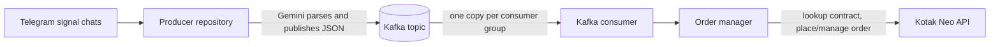

# Kotak Neo Order Consumer

The consumer reads signal events from Apache Kafka, validates each event, and manages orders through the Kotak Neo API. It is an account-side execution service; valid signals can place, modify, or cancel real orders.

> **Live trading:** Starting this app authenticates to Kotak Neo. There is no dry-run mode. Verify the account, environment, lot sizing, product type, risk settings, Kafka source, and order behavior before running it.

## Architecture



The producer and consumer are separate repositories and can run on separate VMs. Kafka is their integration boundary. Both services must agree on the Kafka bootstrap address, topic, security protocol, and event schema.

The consumer starts by authenticating to Kotak Neo using its API credentials, TOTP secret, and MPIN. For each Kafka event it reconstructs a typed signal, resolves the matching live contract and lot size through Kotak, calculates order parameters, and calls the broker API. The order manager tracks pending orders in process memory so later modify/cancel/close signals can refer to them.

### Kafka events and delivery

Events are JSON values keyed by a contract such as `NIFTY_22500_CE`. The payload includes `signal_type`, `action`, index, strike, option type, order condition and prices, raw message, timestamp, and producer metadata. The consumer ignores the `_meta` object when building the signal model.

Kafka consumer offsets are committed manually after processing. The current error path also commits after a message processing exception to prevent a failing event from blocking the partition. As a result, an API or processing failure can skip that event; check logs and the Kotak order book when an execution result is unclear.

Each distinct consumer group receives its own copy of the topic stream. Use a separate group ID for each account that must execute every signal. Consumers sharing one group divide work and do not each receive every message.

## Requirements

- Python 3.10 or newer.
- A reachable Kafka broker with the same topic and security settings as the producer.
- Kotak Neo API credentials for the account that will execute orders.
- Linux for the included VM deployment scripts; local development also works in Windows PowerShell.

## Local setup

### 1. Create a Python environment

Windows PowerShell:

```powershell
py -m venv .venv
.\.venv\Scripts\Activate.ps1
python -m pip install -r requirements.txt
Copy-Item .env.example .env
```

Linux or macOS:

```bash
python3 -m venv .venv
source .venv/bin/activate
python -m pip install -r requirements.txt
cp .env.example .env
```

### 2. Configure the account and Kafka

Edit `.env` and set the Kotak credentials and Kafka connection values. Keep the file private. If Kafka is on the producer VM, set `KAFKA_BOOTSTRAP_SERVERS` to the producer VM's private IP and port, for example `10.128.0.10:9092`; `localhost:9092` only works when the broker is on the same machine as this consumer.

Set `KOTAK_ENVIRONMENT` to the intended Kotak API environment. Check all order sizing fields before the first startup. The default product is `MIS`, default quantity is one lot, and a valid signal may place a live order.

### 3. Start the consumer

```bash
python main.py --account-id default --group-id kotak_executor_default
```

The process authenticates to Kotak and then waits for signals from Kafka. Stop it with `Ctrl+C` during local operation.

Useful CLI overrides:

```text
--account-id ID       Account label shown in logs; defaults to default
--group-id NAME       Kafka group ID; defaults to kotak_executor_<account-id>
--kafka-servers ADDR  Override KAFKA_BOOTSTRAP_SERVERS
--kafka-topic NAME    Override KAFKA_TOPIC_SIGNALS
--lots N              Override DEFAULT_LOTS
--product MIS|NRML    Override DEFAULT_PRODUCT_TYPE
--risk-percent N      Override RISK_PERCENTAGE
--capital N           Override DEFAULT_CAPITAL
```

Use a unique group ID for each independent account that must receive every event. If you run multiple consumer processes in the same group, Kafka distributes partitions/events between them.

## Configuration

Copy `.env.example` to `.env`. Keep credentials only on the VM or in a suitable secret store.

| Variable | Purpose |
| --- | --- |
| `KOTAK_CONSUMER_KEY` | Kotak Neo consumer/API key. Required. |
| `KOTAK_MOBILE_NUMBER` | Mobile number registered with Kotak. Required. |
| `KOTAK_UCC` | Unique Client Code. Required. |
| `KOTAK_TOTP_KEY` | Base32 TOTP secret used to generate login codes. Required and highly sensitive. |
| `KOTAK_MPIN` | Kotak Neo MPIN. Required and highly sensitive. |
| `KOTAK_ENVIRONMENT` | Broker API environment; sample defaults to `prod`. |
| `DEFAULT_PRODUCT_TYPE` | Default product, `MIS` or `NRML`; sample uses `MIS`. |
| `DEFAULT_LOTS` | Default number of lots when risk sizing is not active; sample uses `3`. Requests of 3 or more lots are rounded down to a multiple of 3; 1-2 lot requests are retained. |
| `SL_LIMIT_BUFFER_PERCENT` | Price buffer used for stop-limit orders. |
| `AUTO_CANCEL_ON_REVISE` | Whether a pending order is cancelled when a revised signal arrives. |
| `RISK_PERCENTAGE` | Optional percentage of capital to risk when a signal includes a stop loss. |
| `DEFAULT_CAPITAL` | Optional capital amount used by risk sizing. If risk sizing needs capital and this is unset, the app queries available Kotak funds. |
| `KAFKA_BOOTSTRAP_SERVERS` | Broker address, such as `10.128.0.10:9092` for a producer VM on the same VPC. |
| `KAFKA_TOPIC_SIGNALS` | Must match the producer; defaults to `kotak_trading_signals`. |
| `KAFKA_CONSUMER_GROUP_ID` | Listed in the template as the intended default group. The current `main.py` entry point derives its group from `--group-id` or `--account-id`; the included systemd service therefore uses `kotak_executor_default`. |
| `KAFKA_AUTO_OFFSET_RESET` | Behavior for a new group without a saved offset; sample uses `latest`. Use `earliest` only when you intend a new group to process retained older events. |
| `KAFKA_SECURITY_PROTOCOL` | Kafka security protocol; sample uses `PLAINTEXT`. |
| `KAFKA_SASL_MECHANISM`, `KAFKA_SASL_USERNAME`, `KAFKA_SASL_PASSWORD` | Optional values for a broker configured for SASL. Both apps and broker must use compatible settings. |

The service installed by the included deployment script starts one default account process (`--account-id default`), which uses group `kotak_executor_default`. For a different account/group or CLI sizing override, adjust the systemd service command and ensure that account's credentials are configured before deployment.

### Order behavior

- A buy `ABOVE` signal checks the resolved option contract's live Kotak LTP: below the trigger it places an SL-LMT order, with the limit price buffered by `SL_LIMIT_BUFFER_PERCENT`; at or above the trigger it places a market order.
- A buy `BELOW` signal places a limit order at the stated entry price. It does not place a stop order.
- If the live quote needed for a buy `ABOVE` signal is unavailable or invalid, order placement fails closed instead of guessing.
- `AT` and `LIMIT` signals become limit orders; `MARKET` becomes a market order.
- The client resolves an exact active contract through Kotak and uses the nearest active expiry unless the signal specifies one. It refuses to guess a symbol when lookup fails.
- By default, entry size is 3 lots; sizes of 3 or more are rounded down to multiples of 3. If risk-based sizing can support only 1 or 2 lots, that smaller size is allowed and the signal is reduced to the first 1 or 2 targets, respectively. If even 1 lot exceeds the risk or capital limit, the entry is rejected.
- Pending-order tracking is in memory and is lost when the process restarts. It is not a persistent exchange order ledger.

## Deploy to GCP with GitHub Actions

The workflow in `.github/workflows/deploy.yml` deploys on pushes to `main` that change application/deployment files, or can be started manually from **Actions → Deploy consumer → Run workflow**. Markdown-only changes do not deploy. It syncs this repo, installs Python requirements, and restarts `neo-tel-order-processor.service`. It does not install Kafka; Kafka is managed by the producer deployment.

### GitHub Actions settings

In **Settings → Secrets and variables → Actions**, configure:

**Secrets**

- `GCP_VM_SSH_KEY`: private key for the VM deployment account.
- `GCP_VM_KNOWN_HOSTS`: verified `known_hosts` line for the VM, including the host/IP used by SSH.
- `GCP_VM_HOST`: VM SSH IP or DNS name. This can also be a repository variable.
- `GCP_VM_USER`: VM Linux account. This can also be a repository variable.

**Optional variables**

- `GCP_VM_SSH_PORT`: SSH port; defaults to `22`.
- `CONSUMER_DEPLOY_PATH`: defaults to `/home/<GCP_VM_USER>/apps/neo-tel-order-processor`.

### Prepare the consumer VM

Create the deployment directory and `.env` before the first workflow run. The workflow preserves `.env`, virtual environments, logs, and local runtime files. From a local checkout, copy the example to the VM, then edit it there:

$vmUser = "YOUR_LINUX_USER"
$vmHost = "YOUR_VM_IP_OR_DNS"
$deployPath = "/home/$vmUser/apps/neo-tel-order-processor"
ssh "$vmUser@$vmHost" "mkdir -p '$deployPath'"
scp .env.example "${vmUser}@${vmHost}:$deployPath/.env"
ssh "$vmUser@$vmHost" "chmod 600 '$deployPath/.env' && nano '$deployPath/.env'"
```

For a custom `CONSUMER_DEPLOY_PATH`, use that path in the `scp`, `chmod`, and `nano` commands.

The deploy account needs SSH access, Python 3, and passwordless `sudo` for package installation and systemd operations. If `rsync` is missing, the workflow attempts to install it using `apt-get`, `dnf`, or `yum`. Keep production credentials out of GitHub workflow files and out of the repository.

### Connect to Kafka on the producer VM

The producer workflow starts a broker on the producer VM. Put that VM's private IP and port in this consumer VM's `.env`, for example:

```dotenv
KAFKA_BOOTSTRAP_SERVERS=10.128.0.10:9092
KAFKA_TOPIC_SIGNALS=kotak_trading_signals
KAFKA_SECURITY_PROTOCOL=PLAINTEXT
```

Ensure the producer and consumer topic/security settings match. Configure GCP VPC firewall ingress for TCP `9092` from this consumer VM (or the narrow private subnet it uses). The included Kafka setup uses plaintext, so do not open the broker to the public internet.

## Service operations and logs

The deployment installs and enables `neo-tel-order-processor.service`:

```bash
sudo systemctl status neo-tel-order-processor
sudo systemctl restart neo-tel-order-processor
sudo journalctl -u neo-tel-order-processor -f
sudo journalctl -u neo-tel-order-processor --since today
```

The service is enabled to start at VM boot and restarts if its process exits. It retries every five seconds if Kafka or Kotak is not yet reachable. After stopping the GCP VM outside trading hours, starting the VM again starts this consumer automatically. Check boot configuration with:

```bash
sudo systemctl is-enabled neo-tel-order-processor
```

Every consumer VM has its own independent systemd service, even though each VM uses the same service name. For multiple consumer VMs, give each account a unique Kafka group ID if each account should receive every signal; consumers sharing one group split the workload.

Producer logs on its VM:

```bash
sudo journalctl -u neo-tel-signal-producer -f
```

Kafka container logs on the producer VM:

```bash
sudo docker logs -f trading-kafka
```

## Safety, security, and troubleshooting

- **Live execution:** Valid Kafka messages can create, modify, cancel, or close live Kotak orders. There is no dry-run switch.
- **Review before deployment:** A consumer deployment restarts its process, clearing pending-order tracking. Check open orders and choose a safe time to deploy.
- **No automatic retry on processing failure:** The current consumer commits offsets on its error path too. Inspect logs and broker order status if an event fails.
- **Protect secrets:** Never commit `.env`, API keys, TOTP secrets, MPIN, private SSH keys, or broker credentials. `.gitignore` excludes local configuration.
- **Restrict Kafka access:** Use the VM's private address and a narrow VPC firewall rule. If using managed Kafka, enable TLS/SASL and configure both applications consistently.

| Symptom | Check |
| --- | --- |
| Consumer fails at startup | Check Kotak credentials, TOTP time synchronization, `KOTAK_ENVIRONMENT`, Python dependencies, and service logs. |
| Kafka connection timeout/refused | Check `KAFKA_BOOTSTRAP_SERVERS`, producer container status/logs, advertised private IP, VPC route, and firewall rule for TCP `9092`. |
| No messages arrive | Confirm topic and security settings match, the producer publishes actionable signals, the consumer group ID is correct, and the group offset policy is expected. |
| Order rejected or contract missing | Review consumer logs and Kotak order status; verify index, strike, option type, active expiry, product, quantity, and available funds. |
| Service status is failed | Run `sudo systemctl status neo-tel-order-processor` and `sudo journalctl -u neo-tel-order-processor --since today`. |
