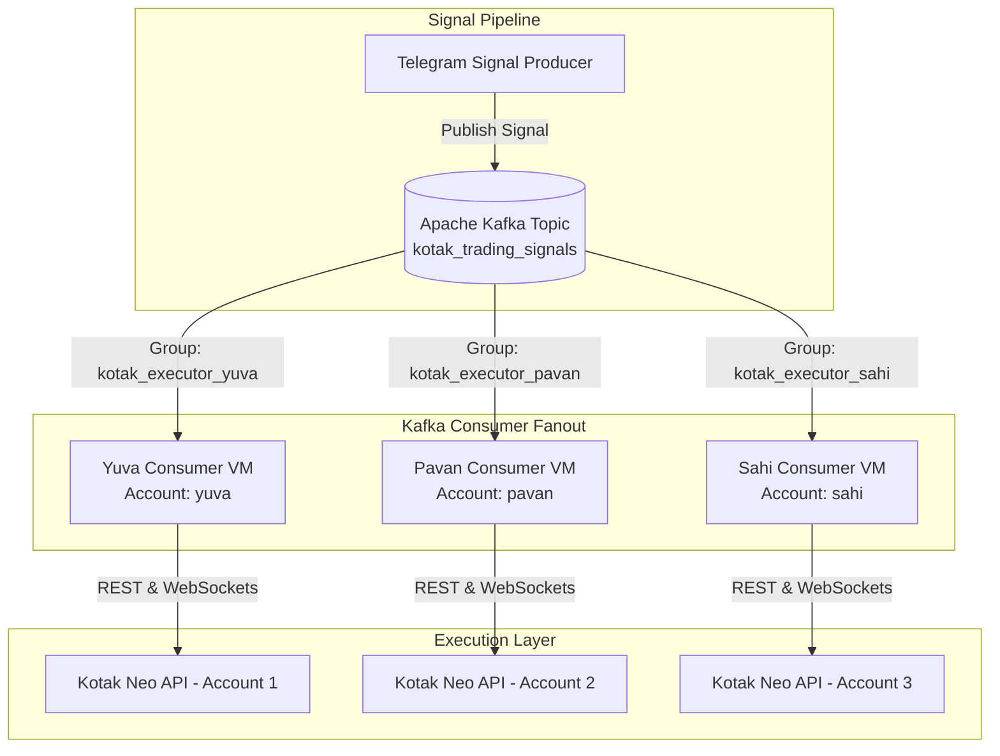

# Kotak Neo Order Consumer

A high-performance, account-level algorithmic trade execution engine for Indian derivatives (NIFTY, BANKNIFTY, SENSEX, FINNIFTY) built on the **Kotak Neo API** and **Apache Kafka**.

The consumer subscribes to incoming trading signals published by the Signal Producer, resolves live exchange scrips and active contract expiries, sizes positions, and manages the complete trade lifecycle (entry, staged profit targets, trailing stop-losses, and emergency exits).

> [!WARNING]
> **Live Trading Daemon:** This service places real orders on your Kotak Securities trading account. Always verify your account credentials, risk parameters, product type, and lot sizing before running in production.

---

## Architecture & Multi-Account Fanout



### Multi-Account & Multi-VM Isolation
- **Independent Consumer Groups**: Every consumer VM runs with its own distinct `KAFKA_CONSUMER_GROUP_ID` (e.g. `kotak_executor_yuva`, `kotak_executor_pavan`, `kotak_executor_sahi`).
- **Full Signal Duplication**: Kafka automatically fans out every trading signal to all active consumer groups simultaneously. An execution delay, rejection, or insufficient fund error on one account has zero impact on the others.

---

## Key Execution & Strategy Features

### 1. Robust Scrip & Expiry Resolution
- Fetches and caches the official Kotak Neo scrip master.
- Features resilient regex-based date matching (`ddMMMyyyy`) for weekly and monthly expiries, with automatic fallback search across active trading symbols.

### 2. Multi-Target Staged Exits & Trailing Stop-Loss
- **Lot Sizing**: Defaults to multiples of 3 lots (e.g., 3, 6, 9 lots) or risk-based sizing.
- **Protective Stop-Loss**: Immediately places a protective sell stop-limit order upon entry order fill.
- **Dynamic Trailing Milestones**:
  - **Target 1 reached**: Executes a partial exit of 1/3 quantity; trails protective stop on remaining 2/3 lots to the average entry price (cost-to-cost / risk-free).
  - **Target 2 reached**: Executes a partial exit of 1/3 quantity; trails protective stop to Target 1.
  - **Target 3 reached**: Squares off the remaining position.

### 3. Immediate Market Exit on Any Exit Signal
When an exit or cancellation instruction arrives (*"Exit at cost to cost"*, *"Exit @253"*, *"close position"*, *"square off"*, or *"exit"*):
- If the trade is currently filled/open (`open_quantity > 0`):
  1. Immediately cancels the active protective stop-loss and pending target orders with the broker.
  2. Submits an instantaneous **Market SELL order** for the entire open quantity.
  3. Updates trade state to `CLOSED`.
- If the entry order is still pending/unfilled: cancels the pending limit order cleanly.

### 4. Asyncio Concurrency & Kafka Resilience
- **Thread Pool Offloading (`asyncio.to_thread`)**: Kotak API operations (scrip search, order placement, 401 re-authentication) perform synchronous HTTP calls. These run in background worker threads so the main `asyncio` event loop is **never blocked**.
- **Heartbeat Protection**: Kafka broker heartbeat pings continue ticking on schedule, completely eliminating `UnknownMemberIdError` and `CommitFailedError` during broker API latency.
- **Tuned Kafka Timeouts**:
  - `session_timeout_ms = 30000` (30 seconds)
  - `heartbeat_interval_ms = 5000` (5 seconds)
  - `max_poll_interval_ms = 300000` (5 minutes)
- **Defensive Offset Commits**: Offset commit errors are caught gracefully, preventing unhandled service crashes.

---

## Configuration Reference (`.env`)

Each VM maintains its dedicated `.env` configuration file at:  
`/home/<user>/apps/neo-tel-order-processor/.env`

| Variable | Description | Default / Example |
| :--- | :--- | :--- |
| `ACCOUNT_ID` | Identifier for this instance shown in logs | `yuva` / `pavan` / `sahi` |
| `KAFKA_CONSUMER_GROUP_ID` | Unique Kafka consumer group ID for this account | `kotak_executor_yuva` |
| `KAFKA_BOOTSTRAP_SERVERS` | Remote Kafka broker host:port | `129.225.75.71:9092` |
| `KAFKA_TOPIC_SIGNALS` | Kafka topic to consume | `kotak_trading_signals` |
| `KAFKA_AUTO_OFFSET_RESET` | Starting offset when no commit exists | `latest` |
| `KOTAK_CONSUMER_KEY` | Kotak Neo API Consumer Key | `<your_consumer_key>` |
| `KOTAK_CONSUMER_SECRET` | Kotak Neo API Consumer Secret | `<your_consumer_secret>` |
| `KOTAK_MOBILE_NUMBER` | Kotak registered 10-digit mobile number | `+91xxxxxxxxxx` |
| `KOTAK_UCC` | Kotak Unique Client Code (UCC) | `<your_ucc>` |
| `KOTAK_PASSWORD` | Kotak account password | `<your_password>` |
| `KOTAK_TOTP_KEY` | Base32 TOTP secret key for automatic OTP generation | `<base32_totp_key>` |
| `KOTAK_MPIN` | 6-digit MPIN for 2FA validation | `123456` |
| `KOTAK_ENVIRONMENT` | API environment | `prod` |
| `DEFAULT_LOTS` | Default execution lots (recommended multiple of 3) | `3` |
| `DEFAULT_PRODUCT_TYPE` | Order product type: `MIS` (Intraday) or `NRML` | `MIS` |
| `SL_LIMIT_BUFFER_PERCENT`| Price buffer percentage for stop-limit trigger orders | `3.0` |

---

## Automated Deployment (GitHub Actions)

Deployments are orchestrated via [`.github/workflows/deploy.yml`](.github/workflows/deploy.yml) and run automatically on push to `main` (or manually via **Run workflow**).

### Deployment Matrix
The workflow deploys to all consumer VMs in parallel:
- **`deploy-yuva`** $\rightarrow$ Deploys to `GCP_VM_HOST_YUVA`
- **`deploy-pavan`** $\rightarrow$ Deploys to `GCP_VM_HOST_PAVAN`
- **`deploy-sahi`** $\rightarrow$ Deploys to `GCP_VM_HOST_SAHI`

### GitHub Secrets & Variables Configuration
Set these in your GitHub repository (**Settings $\rightarrow$ Secrets and variables $\rightarrow$ Actions**):

| Secret / Variable Name | Description |
| :--- | :--- |
| `GCP_VM_HOST_YUVA` | Public IP address of the Yuva Consumer VM |
| `GCP_VM_HOST_PAVAN` | Public IP address of the Pavan Consumer VM |
| `GCP_VM_HOST_SAHI` | Public IP address of the Sahi Consumer VM |
| `GCP_VM_USER` | SSH user across all VMs (e.g. `pawanbudati`) |
| `GCP_VM_SSH_KEY` | Private SSH deployment key (must have access to all consumer VMs) |
| `GCP_VM_KNOWN_HOSTS` | Known hosts entry containing public keys of all VMs |
| `LOG_CLEANUP_CRON` *(Optional)* | Custom cron schedule for daily log rotation & restart (default: `0 8 * * *`) |

### Self-Healing & Pre-Market Automation:
1. **Self-Healing Dependencies**: The deployment script automatically installs `python3-venv` and `python3-pip` via `apt` if missing on fresh Ubuntu/Debian instances.
2. **Pre-Market Daily Restart & Log Cleanup (8:00 AM IST)**: Automatically installs a root cron job into `/etc/cron.d/journal-log-cleanup`:
   ```cron
   0 8 * * * root journalctl --rotate && journalctl --vacuum-time=1s && systemctl restart neo-tel-order-processor.service >/dev/null 2>&1
   ```
   - **Fresh 2FA Tokens**: Kotak Neo session tokens expire daily. Restarting at 8:00 AM ensures the consumer performs a fresh TOTP login and MPIN validation before market open (9:15 AM).
   - **Zero Log Bloat**: Rotates and vacuums systemd journal logs every morning, keeping logs lightning-fast to read.

---

## Manual Deployment (No GitHub Actions)

Deploy directly from your local terminal to any target VM:

### From Windows (PowerShell):
```powershell
cd consumer

# Deploy to all 3 consumer VMs (Yuva, Pavan, Sahi):
.\deploy\manual_deploy.ps1

# Deploy to a specific VM:
.\deploy\manual_deploy.ps1 -Target yuva
.\deploy\manual_deploy.ps1 -Target pavan
.\deploy\manual_deploy.ps1 -Target sahi

# Override host IP directly:
.\deploy\manual_deploy.ps1 -Target pavan -VmHost "34.xx.xx.xx"
```

### From Linux / macOS / Git Bash:
```bash
cd consumer

# Deploy to all VMs
./deploy/manual_deploy.sh all

# Deploy to an individual VM
./deploy/manual_deploy.sh yuva
./deploy/manual_deploy.sh pavan
./deploy/manual_deploy.sh sahi
```

---

## Service Management & Troubleshooting

### Daily Operations on Consumer VM
```bash
# Check service status
sudo systemctl status neo-tel-order-processor

# View live streaming trade execution logs
sudo journalctl -u neo-tel-order-processor -f

# View logs from today only
sudo journalctl -u neo-tel-order-processor --since today

# Restart service manually
sudo systemctl restart neo-tel-order-processor
```

### Common Kotak API Rejections & Fixes

| Error Code / Message | Cause | Resolution |
| :--- | :--- | :--- |
| `401 Unauthorized` (`stCode: 100008`) | Missing/invalid MPIN, expired session, or incorrect UCC credentials. | Verify `KOTAK_MPIN`, `KOTAK_TOTP_KEY`, and `KOTAK_UCC` in `.env`. Ensure F&O trading is activated on the broker account. |
| `403 Forbidden` (`stCode: 1041: LTP not available`) | A Market order was sent when the market is closed or contract has no live ticks. | Normal behavior during off-market testing or deep OTM test strikes. Works automatically during live market hours. |
| `UnknownMemberIdError / CommitFailedError` | The asyncio event loop was blocked longer than `session_timeout_ms`. | Solved in `v2.1+`: all API calls are offloaded to worker threads via `asyncio.to_thread` with a 30s session timeout. |

### Inspecting Consumer Groups on Remote Kafka
Run this on your Kafka host (e.g. OCI VM) to verify all 3 consumers are connected and active:
```bash
docker exec trading-kafka /opt/kafka/bin/kafka-consumer-groups.sh \
  --bootstrap-server localhost:9092 \
  --describe \
  --group kotak_executor_yuva

docker exec trading-kafka /opt/kafka/bin/kafka-consumer-groups.sh \
  --bootstrap-server localhost:9092 \
  --describe \
  --group kotak_executor_pavan

docker exec trading-kafka /opt/kafka/bin/kafka-consumer-groups.sh \
  --bootstrap-server localhost:9092 \
  --describe \
  --group kotak_executor_sahi
```
Each consumer group will display `LAG = 0` with active partition assignments.
