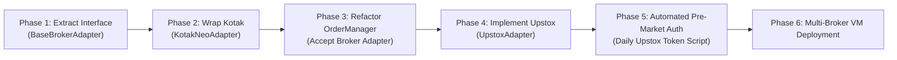

# Multi-Broker Adapter Pattern Architecture Proposal
### Universal Trade Execution Engine for Upstox, Kotak Neo, and Indian Brokers

---

## 1. Executive Summary & Feasibility

### Feasibility Verdict: **100% Feasible**
Every core trading strategy capability in our existing system (scrip and expiry resolution, breakout triggers, staged target partial exits, trailing stop-losses, and emergency square-offs) is natively supported by **Upstox API v2**.

### Architecture Verdict: **Adopt the Broker Adapter Pattern**
Rather than building a separate consumer for Upstox or rewriting the existing one, we introduce a **Broker Adapter Interface**. This decouples broker-specific networking and protocol details from the algorithmic trade lifecycle engine ([`OrderManager`](file:///C:/Users/budat/OneDrive/Desktop/kotak-telegram-trading-system/consumer/src/order_manager.py)).

> [!TIP]
> **Key Value Proposition:** With the Adapter Pattern, **Yuva can trade on Kotak Neo, Pavan on Upstox, and Sahi on Alice Blue** from the *exact same* codebase and Kafka signal stream, with zero code duplication.

---

## 2. Architecture Comparison

### Option A: Separate / Hardcoded Consumers (Anti-Pattern)
- Creates duplicated code repositories (`consumer-kotak`, `consumer-upstox`).
- Any bug fix, order-sizing update, or trailing stop logic change must be manually ported across multiple projects.
- Adding a third broker (e.g. Alice Blue or Zerodha) requires rewriting the engine from scratch.

### Option B: Universal Broker Adapter Pattern (Recommended)
- **Single Execution Core:** [`OrderManager`](file:///C:/Users/budat/OneDrive/Desktop/kotak-telegram-trading-system/consumer/src/order_manager.py) manages 100% of order states, lot sizing, and trailing stops without knowing or caring which broker executes the order.
- **Pluggable Adapters:** Each broker is encapsulated in a single clean module implementing a common interface.
- **Paper Trading Built-in:** Enables a `MockPaperTradingAdapter` that simulates fills and live orders locally on weekends without risking capital.

```mermaid
flowchart TD
    subgraph Signal Processing
        TG[Telegram Channels] --> Producer[Signal Producer VM]
        Producer --> Kafka[(Apache Kafka\nTopic: kotak_trading_signals)]
    end

    subgraph Consumer Core Engine
        Kafka --> Engine[Kafka Signal Consumer]
        Engine --> OM[OrderManager\n- Lot Sizing (3x)\n- Staged Targets (T1/T2/T3)\n- Trailing SL\n- Emergency Square-off]
        OM --> Factory[BrokerFactory]
        Factory --> B_IFACE[<< Interface >>\nBaseBrokerAdapter]
    end

    subgraph Broker Adapters
        B_IFACE --> Kotak[KotakNeoAdapter]
        B_IFACE --> Upstox[UpstoxAdapter]
        B_IFACE --> Alice[AliceBlueAdapter]
        B_IFACE --> Paper[MockPaperTradingAdapter]
    end

    subgraph External Brokers
        Kotak --> K_API[Kotak Neo API]
        Upstox --> U_API[Upstox API v2]
        Alice --> A_API[Alice Blue ANT API]
    end
```

---

## 3. Upstox API v2 Feature-by-Feature Mapping

| Platform Feature | Existing Kotak Neo Method | Upstox API v2 Equivalent | Complexity |
| :--- | :--- | :--- | :--- |
| **Authentication** | TOTP + 6-digit MPIN validation | OAuth 2.0 Access Token (valid until 3:30 AM next day) | Low |
| **Instrument Master** | Daily CSV download per segment | Unified CSV/JSON (`assets.upstox.com/market-quote/instruments`) | Low |
| **LTP / Quotes** | REST Quote / Neo WebSocket | Market Quote API (`/v2/market-quote/ltp`) or WebSocket Feed v2 | Low |
| **Breakout Buy (Abv)** | Limit order (if crossed) or SL-Limit | Order Place API (`/v2/order/place`) with `order_type="SL"` or `"LIMIT"` | Low |
| **Staged Targets (T1-T3)** | Multiples of 3 partial exit orders | Order Place API (`/v2/order/place`) with `quantity=lots//3`, `transaction_type="SELL"` | Low |
| **Trailing Stop-Loss** | Kotak `modify_order` (price & trigger) | Order Modify API (`/v2/order/modify`) with updated `price` & `trigger_price` | Low |
| **Emergency Square-Off** | Cancel pending orders + Market SELL | Order Cancel API (`/v2/order/cancel`) + Market SELL order | Low |
| **Reconciliation** | Kotak `order_report` / `get_order_details`| Upstox Order History API (`/v2/order/history?order_id=...`) | Low |

---

## 4. Technical Specification

### 4.1. Core Interface (`src/brokers/base.py`)
All broker adapters must conform to this abstract base class:

```python
from abc import ABC, abstractmethod
from typing import Dict, Any, Optional
from src.models import OrderPlacement, OrderStatus

class BaseBrokerAdapter(ABC):
    """Abstract interface that all broker adapters must implement."""

    @abstractmethod
    def authenticate(self) -> None:
        """Establish authenticated session with the broker API."""
        pass

    @abstractmethod
    def resolve_symbol(
        self, index: str, strike: float, option_type: str, expiry: Optional[str] = None
    ) -> Dict[str, Any]:
        """
        Resolves trading symbol, instrument token/key, lot size, and tick size.
        Returns: {
            'trading_symbol': str,
            'instrument_token': str,
            'exchange_segment': str,
            'lot_size': int,
            'tick_size': float
        }
        """
        pass

    @abstractmethod
    def get_ltp(self, instrument_token: str, exchange_segment: str) -> float:
        """Fetches the latest Last Traded Price (LTP)."""
        pass

    @abstractmethod
    def place_order(self, placement: OrderPlacement) -> Dict[str, Any]:
        """
        Places a new order with the broker.
        Returns: {'success': bool, 'order_id': str, 'response': dict}
        """
        pass

    @abstractmethod
    def modify_order(
        self, order_id: str, price: float, trigger_price: float, quantity: int
    ) -> Dict[str, Any]:
        """Modifies price, trigger price, or quantity of a pending order."""
        pass

    @abstractmethod
    def cancel_order(self, order_id: str) -> Dict[str, Any]:
        """Cancels a pending order with the broker."""
        pass

    @abstractmethod
    def get_order_status(self, order_id: str) -> OrderStatus:
        """Returns standard OrderStatus: PENDING, COMPLETE, CANCELLED, or REJECTED."""
        pass

    @abstractmethod
    def get_order_details(self, order_id: str) -> Dict[str, Any]:
        """
        Returns normalized fill information:
        {'order_id': str, 'status': OrderStatus, 'filled_quantity': int, 'average_price': float}
        """
        pass
```

---

### 4.2. Upstox Adapter Architecture (`src/brokers/upstox_adapter.py`)

#### Authentication Strategy
Upstox API v2 uses an OAuth access token valid for the trading day:
1. **Interactive / Token Flow**: The user provides `UPSTOX_ACCESS_TOKEN` directly in `.env`.
2. **Automated Daily Refresh (8:00 AM Cron)**: A lightweight Python script runs headlessly via Playwright/Requests to submit TOTP and retrieve a fresh `access_token` automatically every morning.

#### Instrument Key Mapping
Unlike Kotak's text symbols, Upstox uses structured instrument keys:
- Format: `NSE_FO|54321` or `BSE_FO|87654`
- The adapter downloads Upstox's complete instrument list at startup and caches indexed lookups in memory:
  ```python
  # Index key: (INDEX, STRIKE, OPTION_TYPE, EXPIRY) -> instrument_key
  cache[("NIFTY", 23700.0, "CE", "2026-11-12")] = "NSE_FO|54321"
  ```

#### Order Mapping Normalizer
The adapter translates standard `OrderPlacement` into Upstox's payload schema:
```python
upstox_payload = {
    "quantity": placement.quantity,
    "product": "I" if placement.product == "MIS" else "D",
    "validity": placement.validity,
    "price": placement.price if placement.order_type != "MKT" else 0.0,
    "tag": placement.tag or "algo",
    "instrument_token": placement.contract_key,
    "order_type": "SL" if placement.order_type == "SL" else ("LIMIT" if placement.order_type == "L" else "MARKET"),
    "transaction_type": placement.transaction_type,
    "disclosed_quantity": 0,
    "trigger_price": placement.trigger_price,
    "is_amo": False
}
```

---

### 4.3. Broker Factory (`src/brokers/factory.py`)

A factory loads the designated adapter dynamically based on environment configuration:

```python
from typing import Dict, Any
from src.brokers.base import BaseBrokerAdapter
from src.brokers.kotak_adapter import KotakNeoAdapter
from src.brokers.upstox_adapter import UpstoxAdapter
from src.brokers.paper_adapter import MockPaperTradingAdapter

class BrokerFactory:
    @staticmethod
    def create(broker_type: str, config: Dict[str, Any]) -> BaseBrokerAdapter:
        broker = broker_type.lower().strip()
        if broker == "kotak":
            return KotakNeoAdapter(config)
        elif broker == "upstox":
            return UpstoxAdapter(config)
        elif broker == "paper":
            return MockPaperTradingAdapter(config)
        else:
            raise ValueError(f"Unsupported BROKER_TYPE '{broker_type}'. Valid options: kotak, upstox, paper")
```

---

## 5. Configuration Schema

Each VM specifies its broker type and respective credentials in `/home/<user>/apps/neo-tel-order-processor/.env`:

### Scenario 1: Kotak Neo Account (Yuva VM)
```ini
BROKER_TYPE=kotak
ACCOUNT_ID=yuva
KAFKA_CONSUMER_GROUP_ID=kotak_executor_yuva
KAFKA_BOOTSTRAP_SERVERS=129.225.75.71:9092

KOTAK_CONSUMER_KEY=your_kotak_key
KOTAK_CONSUMER_SECRET=your_kotak_secret
KOTAK_MOBILE_NUMBER=+919876543210
KOTAK_UCC=KOTAK123
KOTAK_TOTP_KEY=BASE32KEY
KOTAK_MPIN=123456
DEFAULT_LOTS=3
```

### Scenario 2: Upstox Account (Pavan VM)
```ini
BROKER_TYPE=upstox
ACCOUNT_ID=pavan
KAFKA_CONSUMER_GROUP_ID=kotak_executor_pavan
KAFKA_BOOTSTRAP_SERVERS=129.225.75.71:9092

UPSTOX_API_KEY=your_upstox_api_key
UPSTOX_API_SECRET=your_upstox_api_secret
UPSTOX_REDIRECT_URI=https://127.0.0.1
UPSTOX_ACCESS_TOKEN=your_access_token_here
DEFAULT_LOTS=3
```

---

## 6. Implementation Roadmap



### Phase Breakdown
1. **Phase 1: Interface Definition**: Create `src/brokers/base.py` and normalize `OrderPlacement` and `OrderStatus` structures.
2. **Phase 2: Wrap Existing Kotak Engine**: Move [`KotakClient`](file:///C:/Users/budat/OneDrive/Desktop/kotak-telegram-trading-system/consumer/src/kotak_client.py) logic into `KotakNeoAdapter`. Verify zero regression on existing Kotak execution.
3. **Phase 3: Decouple OrderManager**: Update [`OrderManager`](file:///C:/Users/budat/OneDrive/Desktop/kotak-telegram-trading-system/consumer/src/order_manager.py) to inject `broker: BaseBrokerAdapter` instead of `self.kotak`.
4. **Phase 4: Build Upstox Adapter**: Implement `UpstoxAdapter` utilizing the official `upstox-python-sdk` (or direct REST API calls).
5. **Phase 5: Token Refresh Automation**: Add pre-market Upstox token renewal to the existing 8:00 AM cron schedule.
6. **Phase 6: Deploy & Validate**: Deploy Yuva on Kotak and Pavan on Upstox, verifying concurrent order fanout from a single Telegram signal.

---

## 7. Conclusion

Adopting the **Broker Adapter Pattern** gives the trading system complete broker agnosticism. It preserves 100% of the existing execution features, avoids code fragmentation, and makes supporting any future broker (Upstox, Alice Blue, Zerodha, Dhan) a matter of writing a single adapter class.
